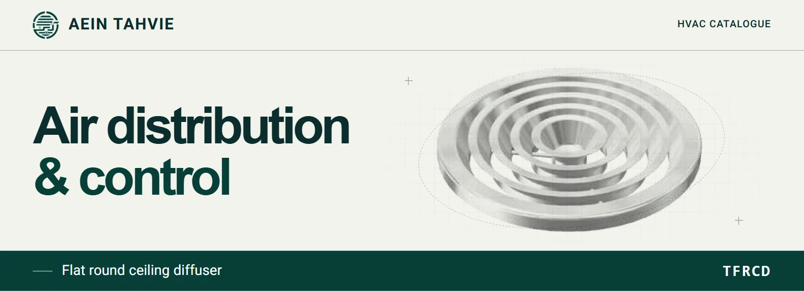
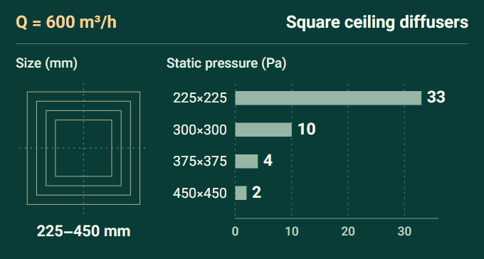

[فارسی](README.md)

# Aein Tahvie Industrial Trading Group

<a href="https://mamadalili.github.io/aein-tahvie-industrial-trading-group/">
  <picture>
    <source media="(max-width: 650px)" srcset="docs/readme/catalogue-en-mobile.webp">
    
  </picture>
</a>

Aein Tahvie’s Persian HVAC catalogue covers 49 products in five families, from grilles and dampers to ductwork and insulation. Search by model code if you have one. If you’re working from a drawing, each product photo comes with a link to its page in the manufacturer’s catalogue.

**[Browse the catalogue](https://mamadalili.github.io/aein-tahvie-industrial-trading-group/#/catalog)** · [Technical library and seven PDFs](https://mamadalili.github.io/aein-tahvie-industrial-trading-group/#/library)

## Two-way, three-way or four-way?

These ceiling diffusers share a square frame. Look at the blades and you can see how many ways each one directs the air. The manufacturer shows the three face patterns side by side. [Catalogue PDF, page 7](https://mamadalili.github.io/aein-tahvie-industrial-trading-group/assets/publications/general19.pdf#page=7)

[Two-way · T2SCD](https://mamadalili.github.io/aein-tahvie-industrial-trading-group/#/product/t2scd) · [Three-way · T3SCD](https://mamadalili.github.io/aein-tahvie-industrial-trading-group/#/product/t3scd) · [Four-way · T4SCD](https://mamadalili.github.io/aein-tahvie-industrial-trading-group/#/product/t4scd)

## Why include the size on a quote request?

Take one row of the manufacturer’s selection chart. Hold airflow at 600 m³/h. For a 300 × 300 mm diffuser, the chart lists a static pressure of **10 Pa**. Move across the same row to 375 × 375 mm and the figure drops to **4 Pa**.

<a href="https://mamadalili.github.io/aein-tahvie-industrial-trading-group/assets/publications/tech.pdf#page=5">
  <picture>
    <source media="(prefers-reduced-motion: reduce)" srcset="docs/readme/pressure-en.webp">
    
  </picture>
</a>

[Original selection chart, technical PDF page 5](https://mamadalili.github.io/aein-tahvie-industrial-trading-group/assets/publications/tech.pdf#page=5)

## From a model code to a quote

Try the four-way model with a quantity of **2** and enter **300 × 300 mm** in the dimensions field. The enquiry basket keeps the model code, quantity and size together. Save the list as a text file or open it in WhatsApp to ask sales for a price and lead time. [Try it with T4SCD](https://mamadalili.github.io/aein-tahvie-industrial-trading-group/#/product/t4scd)

See this item in the Persian enquiry basket

[Product data and catalogue references](data.js)
