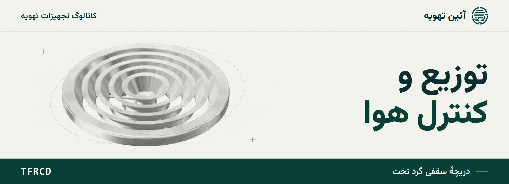
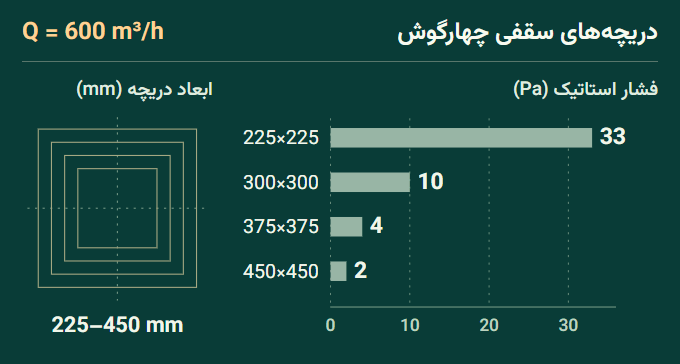
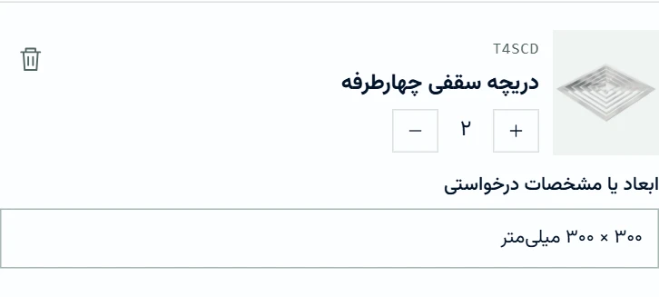

<a href="README.en.md" lang="en">English</a>

# گروه صنعتی بازرگانی آئین تهویه

<a href="https://mamadalili.github.io/aein-tahvie-industrial-trading-group/">
  <picture>
    <source media="(max-width: 650px)" srcset="docs/readme/catalogue-fa-mobile.webp">
    
  </picture>
</a>

در کاتالوگ فارسی آئین تهویه ۴۹ محصول در پنج خانواده پیدا می‌کنی، از دریچه و دمپر تا کانال و عایق. اگر کد مدل را داری، همان را جست‌وجو کن. اگر از روی نقشه انتخاب می‌کنی، کنار عکس هر قطعه لینک صفحهٔ مربوط به آن در کاتالوگ سازنده را می‌بینی.

**[باز کردن کاتالوگ](https://mamadalili.github.io/aein-tahvie-industrial-trading-group/#/catalog)** · [کتابخانهٔ فنی و هفت فایل PDF](https://mamadalili.github.io/aein-tahvie-industrial-trading-group/#/library)

## دوطرفه، سه‌طرفه یا چهارطرفه؟

این سه دریچهٔ سقفی از روبه‌رو قاب چهارگوش مشابهی دارند. از روی آرایش پره‌ها می‌توان دید که هوا از چند جهت پخش می‌شود. سازنده هر سه را کنار هم نشان داده است. [صفحهٔ ۷ فایل کاتالوگ](https://mamadalili.github.io/aein-tahvie-industrial-trading-group/assets/publications/general19.pdf#page=7)

[دوطرفه · T2SCD](https://mamadalili.github.io/aein-tahvie-industrial-trading-group/#/product/t2scd) · [سه‌طرفه · T3SCD](https://mamadalili.github.io/aein-tahvie-industrial-trading-group/#/product/t3scd) · [چهارطرفه · T4SCD](https://mamadalili.github.io/aein-tahvie-industrial-trading-group/#/product/t4scd)

## چرا کنار کد مدل، ابعاد هم می‌نویسیم؟

در جدول سازنده، سطرِ دبی ۶۰۰ مترمکعب بر ساعت را پیدا کن. زیر اندازهٔ ۳۰۰ × ۳۰۰ میلی‌متر، فشار استاتیک **۱۰ پاسکال** است. یک ستون جلوتر، برای دریچهٔ ۳۷۵ × ۳۷۵ میلی‌متر، عدد **۴ پاسکال** را می‌بینی.

<a href="https://mamadalili.github.io/aein-tahvie-industrial-trading-group/assets/publications/tech.pdf#page=5">
  <picture>
    <source media="(prefers-reduced-motion: reduce)" srcset="docs/readme/pressure-fa.webp">
    
  </picture>
</a>

[جدول اصلی سازنده، صفحهٔ ۵ فایل اطلاعات فنی](https://mamadalili.github.io/aein-tahvie-industrial-trading-group/assets/publications/tech.pdf#page=5)

## از انتخاب مدل تا درخواست قیمت

برای نمونه، در صفحهٔ مدل چهارطرفه تعداد را «۲» بگذار و در کادر ابعاد بنویس «۳۰۰ × ۳۰۰ میلی‌متر». در **سبد استعلام**، کد، تعداد و ابعاد کنار هم می‌آیند. می‌توانی فهرست را به‌صورت فایل متنی ذخیره کنی یا در واتساپ برای استعلام قیمت و زمان تحویل بفرستی. [امتحان با مدل T4SCD](https://mamadalili.github.io/aein-tahvie-industrial-trading-group/#/product/t4scd)

دیدن همین قطعه در سبد استعلام

[داده‌های محصولات و ارجاع‌های فنی](data.js)

